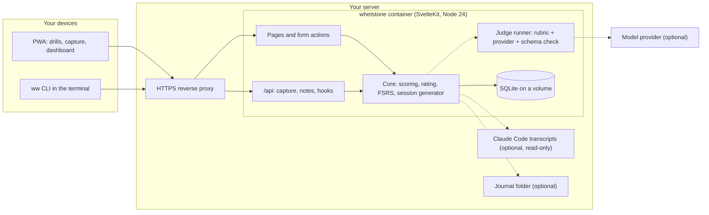

# Whetstone: design

This page records how Whetstone is built and why. The [usage guide](usage.md) describes what it does day to day, and [scoring](scoring.md) gives the formulas.

| Choice | What was chosen |
|---|---|
| Stack | SvelteKit on Node 24, SQLite through Drizzle, Zod, `ts-fsrs` 5 |
| Where it runs | One Docker container, on localhost by default, behind any HTTPS proxy |
| AI judge | Optional. Two roles, quick checks and rubric grading, behind one provider interface for Anthropic, DeepSeek and Ollama |
| Capture | Installable PWA that registers as an Android share target, a `ww` command-line tool, and an HTTP endpoint for hooks |

## The goals

The app trains four things that fail people in real communication: finding a word they know, owning words they have read, recalling where a conversation or an AI session stands, and saying things point-first.

- **Word retrieval comes first.** Tip-of-the-tongue states are access failures, and self-resolving them is what stops them recurring. So the drills make you produce words, never reveal early, and climb a hint ladder of sounds before showing the answer.
- **Every score must be comparable over time.** Objective metrics are computed in code. The AI judge only grades what needs judgment, against versioned rubrics, and stores enough to audit and re-score. A fixed benchmark every four weeks measures real progress apart from the adaptive difficulty.
- **The app adapts.** Each skill has a rating, items have difficulty ratings, and selection aims at 70 to 80 percent success. A weakness map says where you struggle, and the daily session says why each drill was chosen.
- **Resuming parallel Claude Code sessions is a first-class use.** You write a one-minute note when leaving a session, recall before seeing it when returning, and both the note and the recall are scored.
- **Both languages throughout.** Every item carries a language, sessions can be English, Portuguese or mixed, and every chart splits by language. Portuguese means European Portuguese.

## The science behind the design

These principles shaped the drills. They come from research on other populations and tasks, so Whetstone uses them as design guidance and makes no clinical claims.

- **Tip-of-the-tongue states are access failures.** Word production moves from concept to lemma to sound form, and these states occur when the lemma is reached but the sound form is not. Training therefore emphasises producing words.
- **Self-resolving matters.** These states tend to recur on the same words, and error learning is the proposed cause (Warriner and Humphreys, 2008; D'Angelo and Humphreys, 2015). States the person resolves alone recur much less than ones where the answer was shown. So answers are never revealed immediately, a short effort window is enforced, a sound-hint ladder comes before a reveal, and a reveal is followed by producing the word.
- **Sound and meaning cues help.** First sound, syllable count, rhymes and similar words are the basis of Phonological Components Analysis, and Semantic Feature Analysis is its meaning-based counterpart. Both come from aphasia therapy. Here they are structured drills, not validated treatments.
- **Productive retrieval beats receptive study.** Retrieval practice beats re-studying (Roediger and Karpicke, 2006), and going from meaning to word builds more usable vocabulary than going from word to meaning. Cards default to the productive direction.
- **Spacing and difficulty.** Card-like items use FSRS, and selection keeps success around 70 to 80 percent.
- **Resuming a task.** A ready-to-resume plan written before switching reduces attention residue (Leroy and Glomb, 2018). Resumption involves recalling what you were doing and what you were about to do, and cues tied to the goal help (Altmann and Trafton, 2002; Trafton et al., 2003). So the app captures a structured note at suspension, asks you to recall before showing it, scores the recall against the note, and scores whether the note holds a concrete next action.
- **State matters, but the evidence is mixed.** Evidence on sleep and verbal fluency is inconsistent, and aerobic fitness correlates with fewer tip-of-the-tongue states in older adults (Segaert et al., 2018). The app stores a daily check-in so these effects can be measured for one person. Correlations are planned, and should appear only with enough data and honest caveats.
- **Practise the target skill.** Generic brain training transfers poorly, so drills stay as close as possible to real communication.

## Architecture



- **SvelteKit.** It ships little JavaScript, its form actions keep most screens working without client state, and it has a built-in service worker for the PWA. Timers and the hint ladder still need client code, which Svelte handles well.
- **SQLite, one file.** One user and low write volume. Restore is stopping the container and copying a file back.
- **Word frequency is computed offline.** A small Python script uses `wordfreq` to build the lexicon at setup or image build time. The app never needs Python at runtime.
- **Auth.** A passphrase hashed in the environment, and a session cookie. The CLI and hooks use a separate bearer token.
- **Every LLM call is visible.** Settings lists each feature that calls a model and its on/off switch. A usage table logs tokens and cost per day.

## Data model

Most tables have an `id` and a creation time. JSON columns hold what varies by exercise. Language is `en` or `pt-PT` everywhere.

| Table | Holds | Key columns |
|---|---|---|
| `auth_session` | Login sessions | session id, expiry |
| `user_settings` | One row of preferences | default language, session length, effort window seconds, review cap, LLM toggles per feature, keep audio |
| `daily_checkin` | F1 | date (unique), sleep hours, sleep quality, energy, stress, exercise yesterday, main language |
| `rubric` | Versioned rubric files, loaded at start | rubric id, version, file hash, body; a changed file with an unchanged version refuses to load |
| `item` | Anything shown as a prompt | exercise, language, target, prompt JSON, part of speech, Zipf band, concreteness, difficulty rating and deviation, source (seed, tot_log, inbox, generated), parallel set (for benchmarks), validated flag |
| `attempt` | One try at one exercise | exercise, item ids, session id, benchmark run id, raw input, transcript, timings JSON, hints used, state (correct, tot, dont_know, near_miss), objective metrics JSON, normalised scores per skill JSON |
| `judge_eval` | One judge call for an attempt | attempt, rubric id and version, model id, temperature, prompt hash, raw response, parsed scores, tokens, cost, retries |
| `score_override` | The user's score disputes | attempt, criterion, old and new score, reason |
| `skill_rating` | Current rating per skill and language | dimension, language, rating, deviation, volatility |
| `skill_rating_history` | One row per update | dimension, language, attempt, before, after |
| `card` | FSRS state per item | item, direction (productive or receptive), FSRS fields, sticky flag, tags (`tot_item`) |
| `review_log` | FSRS log | card, grade computed, grade overridden, elapsed, latency, hints |
| `vocab_entry` | B1 inbox and stages | word, language, source sentence, enrichment JSON, stage (inbox, learning, active), productive uses, distinct days used |
| `tot_log` | A7 captures | meaning reached for, interlopers, resolution (self, looked_up, open), resolved word, context, language, captured_at |
| `thread` and `thread_keypoint` | C1 to C3 | label or initials, topic, language, recap, editable vague cue, draft/active/archived status, version, FSRS state and next recall due; ordered keypoints with kind (fact, decision, open) |
| `thread_practice` | C2 and C3 reference at the start of a drill | attempt, thread version, original capture time and immutable point snapshot; sent to the browser only after submission |
| `work_session` | D1 to D3 | source (manual, claude_code), project path, Claude session id, title, last activity |
| `resume_note` | D1 | session, stopped at, next action, open risks, waiting on, quality eval |
| `resume_attempt` | D2 | session, note (or transcript summary) used as truth, retrospective and prospective answers, recall scores, time to "back in flow" |
| `daily_session` | Generated plan | date, length, planned drills with the reason for each, completion |
| `benchmark_run` | The battery | date, parallel set used, per-section results |
| `llm_usage` | Cost accounting | date, feature, provider, model, tokens in and out, cost |

## Scoring, judging and adapting

- **Objective scoring lives in pure functions**, one module per exercise, each with unit tests. For A1: unaided correct scores 100, each hint costs 15, a reveal scores 0; latency, TOT and "don't know" are recorded separately and never folded into the score.
- **The judge runner** fills the rubric, calls the model at low temperature, validates the JSON with Zod, and retries up to twice. It stores everything in `judge_eval`, so an attempt can be re-scored later and drift checked on a fixed anchor set.
- **Items are validated by a solver that never sees the answer.** A generated A1 definition is kept only when a separate call, given only the definition, names the target and no equally good alternative. The same pattern is the A5 guesser.
- **Ratings use Glicko-2 per skill and language.** Items carry a rating too, and both update after each attempt. To aim at 75 percent success, selection picks items rated about 190 points below the user's current rating.
- **FSRS grades come from the attempt**, and are shown with an override. Proposed mapping: unaided and under 5 s is Easy; unaided is Good; one or two hints or over 15 s is Hard; a reveal, a wrong answer or three or more hints is Again.
- **A word graduates to active** after three correct productive uses on three separate days. The number is a setting.

## Rubric format

One YAML file per exercise and version under `rubrics/`, named `<id>.v<version>.yaml`. It holds the judge instructions, the input template, the objective metrics computed in code, anchored 1-to-5 criteria with weights, few-shot anchor examples, the JSON output schema and the normalisation formula. The full example for A4 is [`../rubrics/a4-synonym-ladder.v1.yaml`](../rubrics/a4-synonym-ladder.v1.yaml).

## Folder structure

```text
whetstone/
  AGENTS.md, CLAUDE.md         instructions for agents working in the repository
  README.md, LICENSE, NOTICE.md
  docs/                        this design, scoring and selection, the usage guide
  rubrics/                     <id>.v<n>.yaml, one per exercise and version
  content/prompts/             fluency prompt pools, both languages
  src/
    routes/                    home, today, train (/drills), drills (/x/[exercise]), capture, tot, words,
                               sessions, history, dashboard, benchmark, checkin, settings, login, api
    lib/components/            drill header, score ring, hint ladder parts, feedback card, charts, sparkline
    lib/content/               guidance texts and exercise metadata (names, skills, icons)
    lib/core/                  pure, tested logic: text matching, scoring, FSRS mapping, Glicko-2,
                               fluency clusters, item rotation
    lib/server/db/             Drizzle schema and migrations
    lib/server/exercises/      one module per drill: selection, objective scoring, finishing an attempt
    lib/server/judge/          rubric loader, judge and quick-check runner
    lib/server/llm/            provider adapters: DeepSeek, Anthropic, Ollama
    lib/server/claude-code/    transcript reader (read-only)
    lib/server/journal/        journal storage and coach
    lib/server/                services, planner, benchmark, analytics, history, settings, auth
    service-worker.ts
  cli/ww.mjs                   ww note, ww resume, ww tot, ww word, ww sessions
  seed/                        items, prompts, the generator scripts and the loader
  tests/                       scoring, rating, grade mapping, rotation, rubric files
  Dockerfile, docker-compose.yml, docker-compose.override.example.yml
```

## Game identity and catalogue

Implemented 2026-10-04, with Translate it added 2026-10-09. Train separates the standalone games from tools and practice that use saved content. A completed or scored activity is not necessarily a game.

| Game | Pitch | Colour | Illustration |
|---|---|---|---|
| Definition → word | Read the meaning. Find the missing word. | Amber | A magnifying glass over a word card |
| Word Rush | One category or letter. How many words in 60 seconds? | Coral | Letter tiles beside a stopwatch |
| Synonym ladder | Find five alternatives. Pick the most precise. | Violet | Word choices ascending steps |
| Translate it | The English word came. Find the Portuguese one, fast. | Blue | Two speech cards joined by an arrow |

Each game uses its name, pitch, colour and SVG illustration on the Train card and drill header. The card shows the trained skill and English and European Portuguese entry links; Translate it labels its two links by direction, English → Português first. Definition → word also links to a setup screen to read the definition in one language and answer in one or both. Metadata in `src/lib/content/exercises.ts` distinguishes games from other activities; Train selects only entries marked as games. Colour supports recognition alongside text and illustration.

### Tools and practice

Train groups the other activities by the material or purpose they serve:

| Group | Contents | Relationship |
|---|---|---|
| Your vocabulary | Word inbox, tip-of-the-tongue log, Review, Use it | Captured or difficult words feed later practice. The separate Use it activity draws from confirmed inbox words. |
| Your conversations | Conversation recap, Delayed recall, Re-entry drill | Save and confirm a recap before practising recall or writing a re-entry opener. |
| Your work sessions | Resume note, Sessions and resume drill | Record where work stopped and what comes next, then recall that context when returning. |
| Assessments and progress | Benchmark, Check-in, History, Progress | Measure progress, record daily state and inspect past attempts. Benchmark is an assessment. |

Today's session stays prominent above the catalogue and on Home. It combines games and follow-up practice. Settings follows the grouped tools with a description of AI switches, preferences and exports. Score disputes remain attached to attempts in History.

The [usage guide](usage.md#games-and-follow-up-practice) explains the sources of review cards and the distinction between the sentence step within Definition → word and the separate Use it activity.

## Proposed additions and tool adoption

Initial evidence screening, 2026-10-04. Game additions remain recommendations. The daily tool focus below was implemented on 2026-10-05. Every added game should have the same evidence justification as the existing exercises, and training should stay close to real communication.

### Evidence required for an addition

For each candidate, document the everyday difficulty it addresses, the practice mechanism, the relevant study population and outcomes, and what is still an inference. Distinguish evidence for a mechanism from validation of Whetstone's implementation. Define a check on new material and a useful everyday outcome; a higher score on repeated training prompts alone is insufficient. This standard should also apply when reviewing existing exercises.

| Candidate | Fit with the goals | Evidence from this screening | Recommendation |
|---|---|---|---|
| Circumlocution / Taboo, A5 | Practise explaining a concept when its name will not come to mind. A guesser sees only the description. | [Dörnyei, 1995](https://onlinelibrary.wiley.com/doi/abs/10.2307/3587805) reports that focused communication-strategy instruction can improve some strategies. The study concerns second-language learners, not validation of an AI Taboo game for a proficient bilingual. | First candidate for a fuller evidence review. Include instruction, examples and feedback; a guessing score alone is not the studied intervention. |
| Precision rewrite, A6 | Practise making incident updates and stakeholder messages specific while preserving meaning. | Direct match to the intended task is a design rationale. This screening did not establish intervention evidence for the proposed game. | Second candidate to investigate, not yet justified as an evidence-backed addition. |

The vocabulary evidence also illustrates the boundary. [Yanagisawa, 2016](https://www.jstage.jst.go.jp/article/katejournal/30/0/30_11/_article/-char/en) found a productive-retrieval advantage on a productive vocabulary test with 18 undergraduates learning 24 pseudowords. That supports matching practice to the desired form of recall; it does not demonstrate broad improvement in everyday communication from this app.

For A5, use unseen concepts and a listener or blind guesser that receives no target information. Check whether the description communicates the intended meaning within the time allowed. Treat model guesses as an imperfect measure and include a human check before claiming transfer. Add one candidate at a time if its review supports a trial.

### Daily tool focus

Resume note and the tip-of-the-tongue log are the first tools to use regularly. Home keeps two prompts below the daily training plan. Before a work break, choose the intended work session and save where work stopped and the next concrete action. On return, open that session's Notes. When a word will not come, capture its intended meaning even if the word is still unknown. These prompts stay visible after use and across days. The smaller capture row lists the remaining tools without duplicating these two.

[Leroy and Glomb, 2018](https://experts.umn.edu/en/publications/tasks-interrupted-how-anticipating-time-pressure-on-resumption-of/) report four studies supporting a brief ready-to-resume plan to reduce attention residue and protect performance on interrupting work when return time pressure is anticipated. That is evidence for planning at suspension. It is not direct evidence for Whetstone's AI grading or recall-before-reveal step.

Use a cue where the work happens: pin the chosen session's Note page in the work browser with a label such as "Before lunch: leave my next step". A single reminder at a chosen break time is an alternative cue. [Chen et al., 2015](https://www.sciencedirect.com/science/article/abs/pii/S0165178115000360) synthesised 36 comparisons and found that explicit situation-action plans help prospective memory. Applying that finding to this particular app remains a design inference.

The Home prompts use the labels "Before a work break" and "When a word won't come". The resume-note action opens Sessions for an explicit choice of task; the missing-word action opens its capture form directly. A card visible only inside Whetstone cannot by itself remind someone working elsewhere, so a bookmark to the chosen session's note page or the missing-word capture page is a useful companion. No notification schedule is part of this change.

The current shortcut opens the most recently active eligible Claude Code work session. The Home prompt instead opens the session chooser, especially useful when working outside Claude Code. No cross-application session detection or scheduled reminder has been added.

Source scope: the app's entry routes were checked. Published abstracts and university records were reviewed for the studies above. This is an initial screening, not a systematic review or approval to implement another game.

## Translate it (A8): the evidence

Added 2026-10-09. It follows the [evidence standard](#evidence-required-for-an-addition) above.

**The everyday difficulty.** A bilingual speaker who uses a second language for much of daily life may find that, when speaking their first language, the second-language word comes to mind and the first-language one does not. This exercise practises that retrieval from English to European Portuguese. Slower word finding is the most commonly reported sign of first-language attrition in adults immersed in a second language ([Schmid and Köpke, 2008](https://languageattrition.org/wp-content/uploads/2019/02/schmid-kopke-2008.pdf)). [Linck, Kroll and Sunderman, 2009](https://www.psychologicalscience.org/journals/psychological-science/j.1467-9280.2009.02407.x/) found reduced native-language access during immersion. Whether the cause is active suppression of the first language is contested ([Levy et al., 2007](https://www.psychologicalscience.org/journals/psychological-science/j.1467-9280.2007.01844.x/); [Runnqvist and Costa, 2011](https://www.cambridge.org/core/journals/bilingualism-language-and-cognition/article/is-retrievalinduced-forgetting-behind-the-bilingual-disadvantage-in-word-production/AF49D584613AABB37182983805751E15)).

| Design choice | Evidence | Population and limits |
|---|---|---|
| English cue, Portuguese answer, produced not recognised | Practice in the direction of the needed skill: productive learning builds productive knowledge ([Webb, 2009](https://ir.wgtn.ac.nz/handle/123456789/23701)); recall tests beat recognition ([Rowland, 2014](https://courseware.epfl.ch/assets/courseware/v1/fdde2f0aa590bf3b1324077a6bf1540c/asset-v1%3AEPFL%2BDEMO%2B2020%2Btype%40asset%2Bblock/Rowland2014-meta-analysis.pdf), 61 studies, g ≈ 0.50) | Second-language learners and lab word lists, not attriters |
| Retrieve before any help; effort window | Testing beats restudy ([Karpicke and Roediger, 2008](https://pubmed.ncbi.nlm.nih.gov/18276894/)); failed attempts followed by the answer beat reading it ([Kornell, Hays and Bjork, 2009](https://pubmed.ncbi.nlm.nih.gov/19586265/)) | The second finding is from general-knowledge material |
| Several retrievals per round, misses back in spaced Review | The number of retrievals mattered more than depth of processing ([Folse, 2006](https://stars.library.ucf.edu/facultybib2000/6135)); spacing helps second-language learning (Kim and Webb, 2022, meta-analysis) | Classroom learners |
| Phrases, collocations and idioms beside single words | Learners taught formulaic sequences were rated more proficient in speech (Boers et al., 2006, *Language Teaching Research* 10(3)) | One study; replication pending |
| Say it aloud, then type | Words produced aloud are remembered better than words read silently ([MacLeod et al., 2010](https://uwaterloo.ca/memory-attention-cognition-lab/sites/default/files/uploads/files/jep10.pdf)) | Mixed-list designs only; no study compares saying with typing. The app cannot check speech until voice input exists |
| Your own misses, captured and tried at once | Dormant words relearn much faster than new ones ([Hansen, Umeda and McKinney, 2002](https://www.benjamins.com/catalog/sibil.43.09han), 304 returned missionaries) | Second-language data; it supports reactivation, not a specific method |
| Time shown, not scored | Speed gains from word-level training are hard to separate from knowledge gains ([Hulstijn, van Gelderen and Schoonen, 2009](https://www.cambridge.org/core/journals/applied-psycholinguistics/article/automatization-in-second-language-acquisition-what-does-the-coefficient-of-variation-tell-us/554D00B8D979BD1CFF17774087D14326)) | Speaking under shrinking time limits is better supported ([Thai and Boers, 2016](https://metatoc.com/papers/74068-repeating-a-monologue-under-increasing-time-pressure-effects-on-fluency-complexity-and-accuracy)) and needs voice input |

**What remains inference.** No study found trains English intrusions or false friends down in attriters, so the game makes no claim that it does; false friends are included because they are the wrong answer that comes first. Translation direction for attriters was not studied directly. A higher score on the seed items is not the outcome that matters.

**Checks on new material and in life.** Items saved as missing in Portuguese are new material by definition, and their first-try success, hints and time are recorded. The everyday outcome is fewer captured misses per week of Portuguese speaking, together with the user's own sense of how Portuguese conversations go. A spoken 4/3/2-style round under shrinking time is the next candidate once voice input exists.

## The journal

An optional feature, enabled with `WS_JOURNAL_DIR`. You write your journal in Whetstone and can ask for reviews and wording help there.

- **The folder is the only store.** `WS_JOURNAL_DIR` holds `Journal/`, optionally a read-only `Journal/Voice Journals/`, and `Whetstone/`. Written entries are Markdown files at `Journal/<yyyy>/<yy.mm>/<yyyy-mm-dd>.md`, and Whetstone edits them in place; a file is editable only when its name starts with a date that matches its folders. Reports go to `Whetstone/Reports/<yyyy-mm-dd hhmm>.md` with the picked entries and the request in the file, and wording requests to `Whetstone/Wording/<yyyy-mm>.md`. Nothing else in the folder is read or written; `src/lib/server/journal/store.ts` is the only code that touches it.
- **No journal text in the database.** The journal model features call `check()` with `keepRaw: false`, so `judge_eval` keeps only the purpose, model and token counts. Usage still counts in `llm_usage`.
- **Writing after midnight counts as the night before**, until 05:00. A new entry's file is created on its first save, never empty.
- **A change made elsewhere is never overwritten.** Each save sends the hash of the version the editor started from; if another app changed the file since, the save is refused and you choose between the two versions.
- **Reports run only on request**, on the entries you name in a sentence or pick by hand, with what you want looked at, which the model answers first. A sentence is turned into date ranges by a quick model call that sees only the request, today's date and the journal's first and last day; code then picks the entries. Code computes the numbers (vocabulary range as MTLD, sentence length, sentence openers, fillers per 1,000 words, repeated words, words used far more than in the whole written journal, missing apostrophes, share of less common words) and the model uses them as evidence. A voice journal contributes only its raw transcript, never the AI summary above it. The model is the grading role, with reasoning.
- **Wording help** sends the selected words, the sentence around them and what you say you mean; it never sees the rest of the entry. A suggestion goes into the entry only when you tap it, and a single word can go to the vocabulary inbox from there or from a report.
